# Ascend

Ascend is a student-first UPI credit line experience built around transparent cash flow, small limits, and on-time progress. This repository contains the complete local web application: the redesigned frontend, original backend workflows, sandbox providers, onboarding flow, lender tools, family view, and Android APK download.

> Northbridge Bank is a fictional lender used for this prototype. KYC, Account Aggregator, bureau, UPI, and AutoPay are clearly labelled sandbox providers.

## What is in this repository

- Modern responsive landing page with lime, ink, and paper visual language
- Smooth route transitions and scroll reveals
- Student onboarding, sign-in, KYC, cash-flow, limit, and payment flows
- Student dashboard, score, rewards, statement, slip, and settings pages
- Parent guide and read-only Family View
- Lender and admin surfaces with demo controls
- Original database, services, business engines, API registry, and security model
- Android APK available at [`public/downloads/ascend.apk`](public/downloads/ascend.apk)

## Local preview

The project is intentionally local-only at this stage. No production deployment is configured by this README.

```bash
npm install
npm run db:setup
npm run dev
```

Open [http://localhost:3000](http://localhost:3000). For the local sandbox, use `OTP_PROVIDER=sandbox`; the sign-in code is shown in the UI and no real email is sent.

Useful commands:

```bash
npm run lint
npm run build
npm test
```

## Local preview gallery

The screenshots below were captured from the local application at `http://127.0.0.1:3000` after the current UI build. They are repository assets, not screenshots from a deployed site.

### Public experience

<table>
  <tr>
    <td>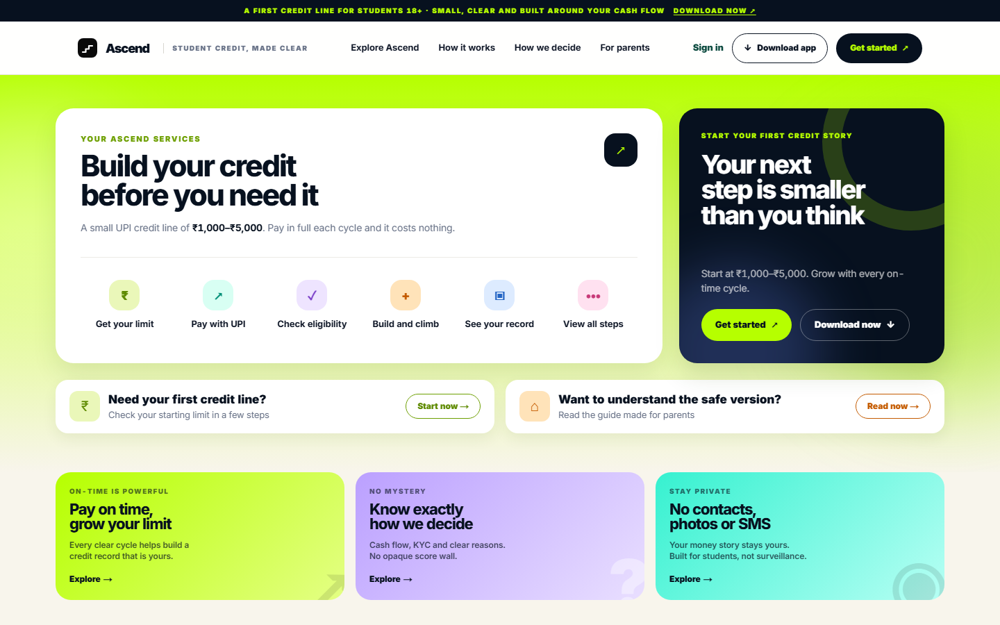<br><strong>Landing page</strong></td>
    <td>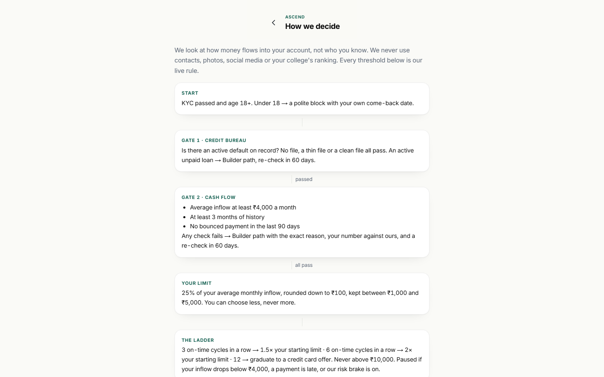<br><strong>How we decide</strong></td>
    <td>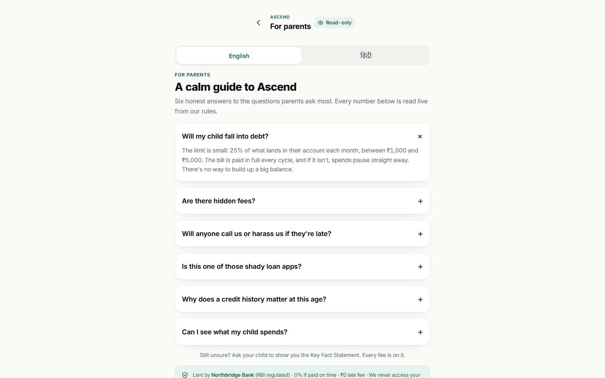<br><strong>Parent guide</strong></td>
  </tr>
  <tr>
    <td><br><strong>Sign up</strong></td>
    <td>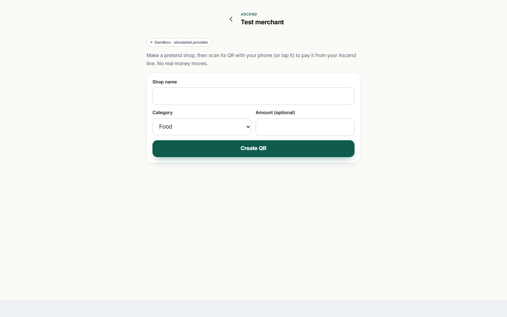<br><strong>Sandbox merchant</strong></td>
    <td><br><strong>Not found</strong></td>
  </tr>
</table>

### Landing page scroll-through

The front page is a long-form experience, so the gallery includes multiple viewport captures rather than a single hero image. These show the visitor journey from the opening promise through the feature cards, workflow, editorial story, comparison, guidance panels, and final call-to-action.

<table>
  <tr>
    <td>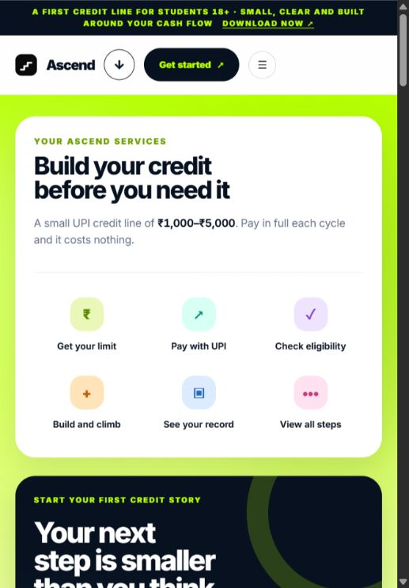<br><strong>01 · Hero</strong></td>
    <td>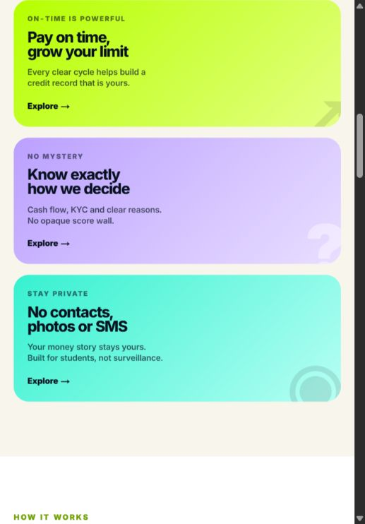<br><strong>02 · Feature cards</strong></td>
    <td>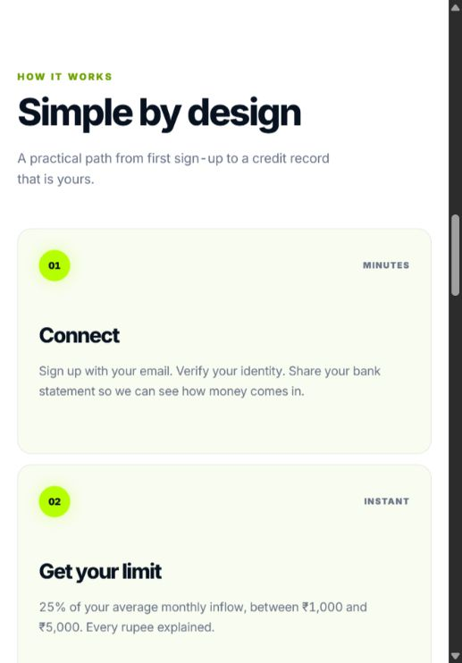<br><strong>03 · How it works</strong></td>
  </tr>
  <tr>
    <td>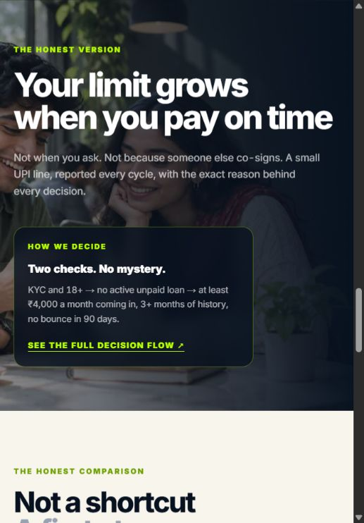<br><strong>04 · Editorial story</strong></td>
    <td>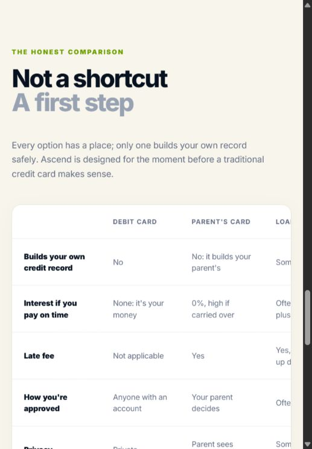<br><strong>05 · Honest comparison</strong></td>
    <td>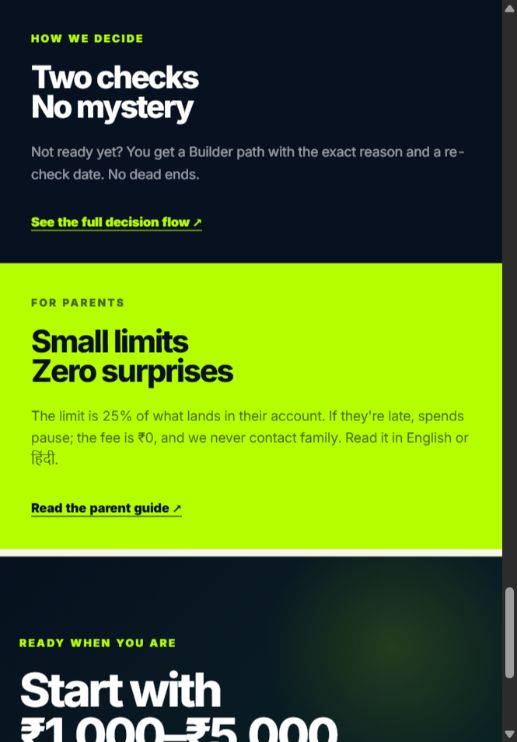<br><strong>06 · Guides</strong></td>
  </tr>
  <tr>
    <td>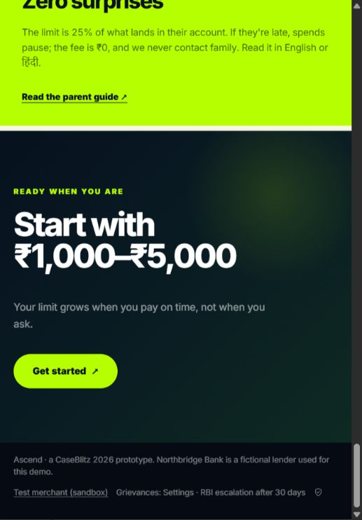<br><strong>07 · Final call-to-action</strong></td>
  </tr>
</table>

### Product and account surfaces

These routes are protected by the original session flow. Without a seeded local session, the preview correctly lands on the sign-in boundary; the screenshots document that real route behavior.

<table>
  <tr>
    <td><br><strong>Dashboard</strong></td>
    <td><br><strong>Family view</strong></td>
    <td><br><strong>Lender</strong></td>
  </tr>
  <tr>
    <td><br><strong>Notifications</strong></td>
    <td><br><strong>Pay</strong></td>
    <td><br><strong>Rewards</strong></td>
  </tr>
  <tr>
    <td><br><strong>Score</strong></td>
    <td>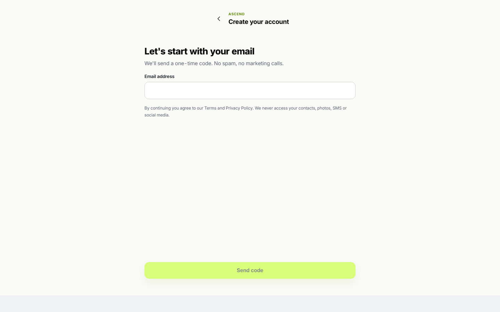<br><strong>Settings</strong></td>
    <td><br><strong>Key Fact Statement</strong></td>
  </tr>
  <tr>
    <td><br><strong>Slip</strong></td>
    <td><br><strong>Statement</strong></td>
    <td><br><strong>Profile onboarding</strong></td>
  </tr>
</table>

### Onboarding route coverage

<table>
  <tr>
    <td><br><strong>Age block</strong></td>
    <td><br><strong>AutoPay</strong></td>
    <td><br><strong>Builder</strong></td>
    <td><br><strong>Bureau</strong></td>
  </tr>
  <tr>
    <td><br><strong>Cash flow</strong></td>
    <td><br><strong>Consent</strong></td>
    <td><br><strong>Enrolment</strong></td>
    <td><br><strong>KYC</strong></td>
  </tr>
  <tr>
    <td><br><strong>Ladder</strong></td>
    <td><br><strong>Limit</strong></td>
    <td><br><strong>Profile</strong></td>
    <td><br><strong>Sign-in boundary</strong></td>
  </tr>
</table>

## Architecture

```text
app/             Next.js App Router pages and API routes
components/      Shared UI, shell, icons, and client interactions
lib/engine/      Pure business rules with no database access
lib/config/      Editable configuration schema and loader
lib/db/          Drizzle schema, database connection, and actor context
lib/services/    Application services for onboarding, line, family, lender, and admin
lib/api/         Typed API action registry and validation
lib/providers/   Sandbox adapters for OTP, KYC, UPI, and AutoPay
db/              Migrations, seed configuration, and setup script
tests/           Unit, database, and journey tests
public/          Editorial assets, screenshots, and the Android APK
```

The request path remains:

```text
page or API route → service → engine(s) → database
```

The engines stay database-independent so the core rules remain testable with plain inputs.

## Backend and security preserved

- Row-level security is applied through `withActor()` and the restricted `ascend_app` role
- Sessions use signed JWT cookies and email one-time codes
- PAN and Aadhaar are stored only as masked trailing characters
- The app does not request contacts, photos, SMS, or location permissions
- Family View exposes only its explicitly allowed read-only fields
- Sandbox providers remain labelled and use only supplied demo data

## Current validation

The local project currently passes:

```text
npm run lint
npm run build
```

Deployment is intentionally left for a later step when the repository owner requests it.
